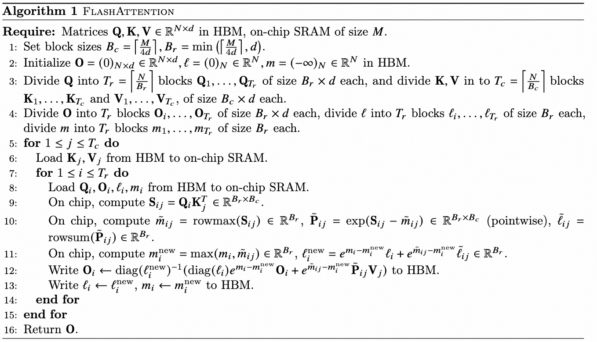

FlashAttention 的目标是**加速 Attention 计算并减少显存占用**。它的核心思想是减少对 HBM 的读写次数：把 Q、K、V 切分成小块放进 SRAM，在片上完成计算。

## 动机与难点

标准 Attention 计算 $$O = softmax(QK^T)V$$ 时，会把中间结果 $$S = QK^T$$ 和 $$P = softmax(S)$$ 完整写回 HBM，再读出来参与下一步计算。随着 context 变长，S 和 P 的大小以 $$N^2$$ 增长，既占显存，又带来大量访存 IO。

分块计算的难点在于 softmax：它需要用到**每一行的最大值和每一行的总和**，而这两个量要等整行都算完才能得到，因此很难直接分块并行。

FlashAttention 的做法是**分块计算 + kernel fusion**：把 softmax 拆解开，在处理每一块时不断更新当前的行最大值和行总和，在不损失精度的前提下，逐块得到 softmax 和 Attention 的结果。

下面从 softmax 的几种计算方式开始，一步步推导到 FlashAttention。

## 原始 softmax

$$softmax(\{x_1, \dots, x_N\}) = \left\{\frac{e^{x_i}}{\sum^N_{j=1}e^{x_j}}\right\}^N_{i=1}$$

指数增长很快，$$x_i$$ 稍大时 $$e^{x_i}$$ 就容易溢出。

## Safe softmax

在原始 softmax 的基础上减去最大值，保证计算过程中不会发生数值溢出：

$$safeSoftmax(\{x_1, \dots, x_N\}) = \left\{\frac{e^{x_i-m}}{\sum^N_{j=1}e^{x_j-m}}\right\}^N_{i=1}, \quad m=\max^N_{j=1}(x_j)$$

Safe softmax 需要三个循环才能得到最终结果：

1. 求每行的最大值：for $$i$$ in $$[1, N]$$ do $$m_i \leftarrow \max(m_{i-1}, x_i)$$
2. 求每行的总和：for $$i$$ in $$[1, N]$$ do $$d_i \leftarrow d_{i-1} + e^{x_i-m_N}$$
3. 计算 softmax 结果：for $$i$$ in $$[1, N]$$ do $$a_i \leftarrow \frac{e^{x_i-m_N}}{d_N}$$

如果 GPU 上没有足够的 SRAM 存下这三步的中间结果，就需要把 Q 和 K 读取三次，并每次重新计算 $$x$$，访存效率很低。而且随着 context 变长，在有限的显存里存下这么大的矩阵也很困难。

## Online softmax

在 safe softmax 中，$$d_i$$ 的递推依赖 $$m_N$$，必须先算完整行的最大值。如果能找到一个与 $$m_N$$ 无关的递推公式，就可以把求最大值和求总和合并到同一个循环里。

构造定义：

$$d'_i = \sum^i_{j=1}e^{x_j-m_i}$$

当 $$i = N$$ 时，$$d'_N = d_N$$。推导 $$d'_i$$ 的递推关系：

$$
\begin{aligned}
d'_i &= \sum^i_{j=1}e^{x_j-m_i} \\
&= \left(\sum^{i-1}_{j=1}e^{x_j-m_i}\right)+e^{x_i-m_i} \\
&= \left(\sum^{i-1}_{j=1}e^{x_j-m_{i-1}}\right)e^{m_{i-1}-m_i}+e^{x_i-m_i} \\
&= d'_{i-1}e^{m_{i-1}-m_i}+e^{x_i-m_i}
\end{aligned}
$$

此时 $$d'_i$$ 的递推只依赖 $$m_i$$ 和 $$m_{i-1}$$。循环到 $$i = N$$ 时，就同时得到了整行的最大值和总和。于是 online softmax 只需要两个循环：

1. 同时求最大值和总和：for $$i$$ in $$[1, N]$$ do

    $$
    \begin{aligned}
    m_i &\leftarrow \max(m_{i-1}, x_i) \\
    d'_i &\leftarrow d'_{i-1}e^{m_{i-1}-m_i} + e^{x_i-m_i}
    \end{aligned}
    $$

2. 计算 softmax 结果：for $$i$$ in $$[1, N]$$ do $$a_i \leftarrow \frac{e^{x_i-m_N}}{d'_N}$$

每次只需要把一部分 Q 和 K 读到 SRAM 中计算出 $$x$$。相比 safe softmax，online softmax 少了一次对 Q、K 的完整读取，也少了一次 $$x$$ 的重新计算。代价是每一步要多算一次缩放因子 $$e^{m_{i-1}-m_i}$$，计算量略有增加。

## FlashAttention

### 两遍循环版本

Attention 最终要求的是 $$O = softmax(QK^T)V$$。直接套用 online softmax，对第 $$k$$ 行有：

1. for $$i$$ in $$[1, N]$$ do

    $$
    \begin{aligned}
    x_i &\leftarrow Q[k,:]K^T[:,i] \\
    m_i &\leftarrow \max(m_{i-1}, x_i) \\
    d'_i &\leftarrow d'_{i-1}e^{m_{i-1}-m_i} + e^{x_i-m_i}
    \end{aligned}
    $$

2. for $$i$$ in $$[1, N]$$ do

    $$
    \begin{aligned}
    a_i &\leftarrow \frac{e^{x_i-m_N}}{d'_N} \\
    o_i &\leftarrow o_{i-1} + a_iV[i,:]
    \end{aligned}
    $$

3. 写回结果：$$O[k,:]\leftarrow o_N$$

第 2 个循环依赖 $$d'_N$$，所以和 safe softmax 一样，必须等第一个循环结束后才能开始。

### 一遍循环版本

仿照 online softmax 的思路，定义

$$o'_i = \sum^i_{j=1}\frac{e^{x_j-m_i}}{d'_i}V[j,:]$$

推导它的递推关系：

$$
\begin{aligned}
o'_i &= \left(\sum^{i-1}_{j=1}\frac{e^{x_j-m_i}}{d'_i}V[j,:]\right) + \frac{e^{x_i-m_i}}{d'_i}V[i,:] \\
&= \left(\sum^{i-1}_{j=1}\frac{e^{x_j-m_{i-1}}}{d'_{i-1}}\frac{e^{x_j-m_i}}{e^{x_j-m_{i-1}}}\frac{d'_{i-1}}{d'_i}V[j,:]\right) + \frac{e^{x_i-m_i}}{d'_i}V[i,:] \\
&= \left(\sum^{i-1}_{j=1}\frac{e^{x_j-m_{i-1}}}{d'_{i-1}}V[j,:]\right)\frac{d'_{i-1}}{d'_i}e^{m_{i-1}-m_i} + \frac{e^{x_i-m_i}}{d'_i}V[i,:] \\
&= o'_{i-1}\frac{d'_{i-1}e^{m_{i-1}-m_i}}{d'_i} + \frac{e^{x_i-m_i}}{d'_i}V[i,:]
\end{aligned}
$$

这样 $$o'_i$$ 的计算就不再依赖 $$d'_N$$，整个 Attention 可以在一个循环里完成：

1. for $$i$$ in $$[1, N]$$ do

    $$
    \begin{aligned}
    x_i &\leftarrow Q[k,:]K^T[:,i] \\
    m_i &\leftarrow \max(m_{i-1}, x_i) \\
    d'_i &\leftarrow d'_{i-1} e^{m_{i-1}-m_i} + e^{x_i - m_i} \\
    o'_i &\leftarrow o'_{i-1} \frac{d'_{i-1}e^{m_{i-1}-m_i}}{d'_i} + \frac{e^{x_i-m_i}}{d'_i}V[i,:]
    \end{aligned}
    $$

2. 写回结果：$$O[k,:]\leftarrow o'_N$$

更进一步，对 Q 和 K 做 tiling，把上面逐元素的递推换成逐块的递推，就得到了分块版本的 FlashAttention。

从算法逻辑上看，现在只需要把 Q、K、V 读取一次，就能在一个 kernel 里完成全部 Attention 计算。原来 self attention 的 3 步被合并成了 1 步，**既省去了 S 和 P 的显存占用，也减少了访存次数。**

## 算法

**Forward pass**：通过上面对 softmax 的改造，避免了对 S 和 P 的存储和读取。论文中的 Algorithm 1 如下：

{: .mx-auto.d-block :}

Algorithm 1 FlashAttention，图源：<a href="https://arxiv.org/abs/2205.14135">FlashAttention</a>

和前面的推导对照来看：

- $$\ell$$ 就是前面的行总和 $$d'$$，$$m$$ 就是行最大值，$$\tilde{m}_{ij}$$、$$\tilde{P}_{ij}$$、$$\tilde{\ell}_{ij}$$ 是当前块内的局部值。第 11 步是 $$d'_i$$ 递推的分块版本，第 12 步是 $$o'_i$$ 递推的分块版本，只是把逐元素的更新换成了逐块的更新。
- 分块大小由 SRAM 容量 $$M$$ 决定，保证 $$Q_i, K_j, V_j, O_i$$ 等几个块能同时放进 SRAM。
- 外层循环遍历 $$K, V$$ 的分块，内层循环遍历 $$Q$$ 的分块。每个 $$K_j, V_j$$ 只从 HBM 读取一次，$$S_{ij}$$ 和 $$\tilde{P}_{ij}$$ 只存在于片上，从不写回 HBM。

**Backward pass**：使用重计算（recomputation）。反向传播需要用到 S 和 P，但前向阶段没有保存它们，因此在反向阶段利用保存下来的统计量 $$m$$、$$d'$$ 重新计算出来。

## 效果

在 8 张 A100 上的实验：使用 FlashAttention 训练 GPT-2 small 时，即使 context 长度是 Megatron-LM 的 4 倍，训练速度仍然快 30%，同时 perplexity 降低了 0.7。

## 参考

- Tri Dao et al. [FlashAttention: Fast and Memory-Efficient Exact Attention with IO-Awareness](https://arxiv.org/abs/2205.14135). NeurIPS 2022.
- Maxim Milakov, Natalia Gimelshein. [Online normalizer calculation for softmax](https://arxiv.org/abs/1805.02867). 2018.
