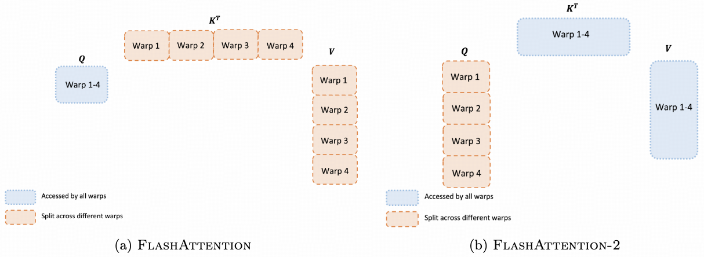
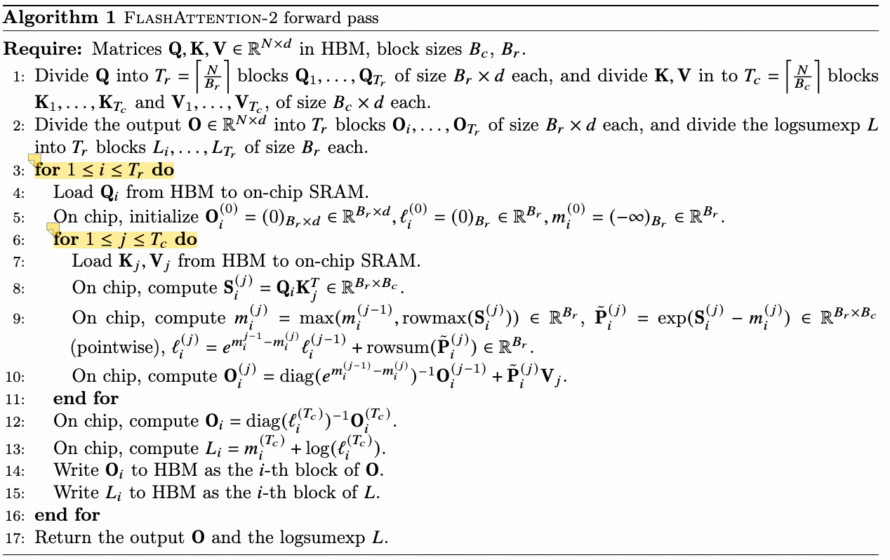
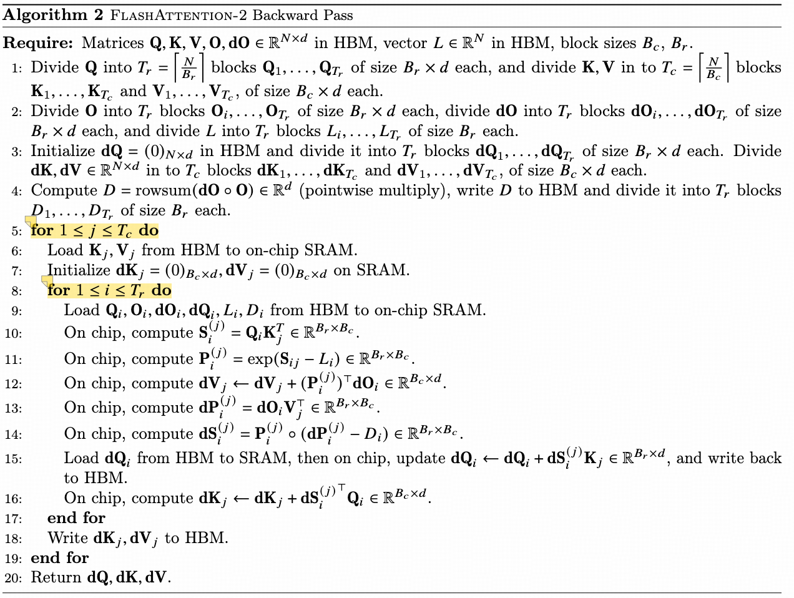

FlashAttention V2 的目标是**在 V1 的基础上进一步提升 Attention 的计算效率**。它的核心思想和 [FlashAttention V1]({{ site.baseurl }}) 一致：通过 tiling 和 recompute，减少对 HBM 的读写。

相比 V1，V2 主要做的是一些工程上的优化，可以归纳为三点：

1. 减少非 matmul 的冗余计算，提高 Tensor Core 运算的占比；
2. forward 和 backward 都增加 seqlen 维度的并行，forward 中调换了 Q 和 K、V 的循环顺序；
3. 更好的 warp partitioning 策略，避免 split-K。

## 减少非 matmul 的冗余计算

GPU 上 matmul 可以用 Tensor Core 计算，吞吐远高于其他运算。论文中提到，A100 的 FP16/BF16 matmul 峰值算力是 312 TFLOPs，而非 matmul 运算只有 19.5 TFLOPs。也就是说，一次非 matmul 运算的代价相当于十几次 matmul 运算，因此要尽量减少 softmax 中的除法、指数这类非 matmul 运算。

### Forward：只在最后做一次 rescale

V1 在每次迭代中都会把 O 除以当前的行总和 $$\ell^{new}$$，保证 O 始终是归一化后的结果：

$$O_i \leftarrow \mathrm{diag}(\ell_i^{new})^{-1} \left( \mathrm{diag}(\ell_i) e^{m_i - m_i^{new}} O_i + e^{\tilde{m}_{ij} - m_i^{new}} \tilde{P}_{ij} V_j \right)$$

V2 则在迭代过程中维护一个未归一化的 $$\tilde{O}$$，每次只根据最大值的变化做缩放，不再做除法：

$$
\begin{aligned}
m_i^{(j)} &= \max\left(m_i^{(j-1)}, \mathrm{rowmax}(S_i^{(j)})\right) \\
\ell_i^{(j)} &= e^{m_i^{(j-1)} - m_i^{(j)}} \ell_i^{(j-1)} + \mathrm{rowsum}\left(e^{S_i^{(j)} - m_i^{(j)}}\right) \\
\tilde{O}_i^{(j)} &= \mathrm{diag}\left(e^{m_i^{(j-1)} - m_i^{(j)}}\right) \tilde{O}_i^{(j-1)} + e^{S_i^{(j)} - m_i^{(j)}} V_j
\end{aligned}
$$

等所有 K、V 分块都处理完，最后再统一 rescale 一次：

$$O_i = \mathrm{diag}\left(\ell_i^{(T_c)}\right)^{-1} \tilde{O}_i^{(T_c)}$$

这样每次迭代都少了一次除法。之所以能只在最后 rescale 一次，是因为 V2 调换了内外循环的顺序：外循环遍历 Q，内循环遍历 K、V。同一个 $$Q_i$$ 的所有迭代都在同一个 thread block 里完成，$$\tilde{O}_i$$ 一直留在片上，直到最后才写回（详见下一节）。

### Backward：只保存 logsumexp

V1 的 forward 需要分别保存 $$m$$ 和 $$\ell$$ 两个序列，供 backward 重计算 P 时使用。V2 只保存一个 logsumexp：

$$L_i = m_i + \log(\ell_i)$$

这样 backward 中重计算 P 的过程就简化为：

$$P_{ij} = \mathrm{diag}(\ell_i)^{-1} \exp(S_{ij}^{masked} - m_i) \quad \rightarrow \quad P_{ij} = \exp(S_{ij} - L_i)$$

既少存了一个序列，也省去了 backward 中的除法。

## 增加 seqlen 维度的并行

### Forward：调换循环顺序

在 V1 的 forward 中，外层循环遍历 K、V，内层循环遍历 Q。每完成一次内层循环，得到的只是 O 分块的一个中间结果，而不是最终结果，因此每次内循环迭代都要对 O、$$\ell$$、$$m$$ 做一次 HBM 的读写。

实际上，在 Attention 的计算中，不同 query 的计算是完全独立的。如果外层循环先遍历 Q，就可以把不同的 query 分块放到不同的 thread block 中计算，block 之间不需要任何通信。每个 block 内部遍历所有 K、V 分块，最后只把 O 写回 HBM 一次，省去了内循环中对 O、$$\ell$$、$$m$$ 的反复读写。

### Forward：在 seqlen 维度上并行

V1 只在 batch_size 和 head_num 两个维度上并行，每个 thread block 处理一个 head。当 seqlen 比较长、batch_size 比较小时，thread block 的数量太少，占不满 GPU 上的 SM，效率会大幅下降。

V2 在此基础上增加了行方向（Q 的 seqlen 方向）的并行。Attention 在行方向上天然可以拆分，不同 block 之间不需要额外通信，因此提高了 GPU 的占用率。

### Backward：在列方向上并行

V2 在 backward 中也增加了 seqlen 维度的并行，但没有像 forward 那样调换循环顺序，而是保持外层遍历 K、V，内层遍历 Q，在列方向（K、V 的 seqlen 方向）上并行。

原因是通信量：按照先 K、V 再 Q 的顺序，每个 block 负责的 $$dK_j$$、$$dV_j$$ 可以在 block 内累加完成，只有 $$dQ_i$$ 需要在不同 block 之间累加。如果调换顺序，就变成 $$dK$$ 和 $$dV$$ 都需要在 block 之间累加，通信量更大。因此 backward 采用先 K、V 再 Q 的顺序会稍快一些。

## 更好的 warp partitioning

在一个 thread block 内部，计算还会进一步分给多个 warp（通常是 4 个或 8 个）。

- **V1 的 split-K**：把 K、V 切分给不同的 warp，Q 被所有 warp 共享。每个 warp 算出 $$QK^T$$ 的一部分后，还要乘上对应的 V 切片，最后不同 warp 的结果必须写到 shared memory、同步之后再相加。这一步跨 warp 的 reduction 带来了大量 shared memory 读写。
- **V2 的做法**：改为把 Q 切分给不同的 warp，K、V 被所有 warp 共享，也就是从复用 Q 变成了复用 K、V。每个 warp 算出 $$QK^T$$ 的一部分后，直接乘上共享的 V，就得到自己负责的那部分输出，warp 之间不需要通信。

这样既避免了 softmax 计算时跨 warp 的 reduction，也减少了对 shared memory 的读写次数。

## 算法

### Forward

### Backward

## 效果

<!-- TODO: 插入论文中的实验结果图（Fig. 4 - Fig. 7） -->

论文在 A100 80GB SXM4 上测量了不同 Attention 实现的运行时间，覆盖有无 causal mask、head dimension 为 64 或 128 的几种设置：

| 对比对象 | FlashAttention-2 的加速比 |
| --- | --- |
| FlashAttention（原版） | 约 2× |
| xformers 中的 FlashAttention（cutlass 实现） | 约 2× |
| Triton 实现的 FlashAttention | forward 约 1.3-1.5×，backward 约 2× |
| PyTorch 标准 Attention 实现 | 最高约 10× |

Benchmark 设置：

- seqlen 取 512、1k、……、16k，并调整 batch size，使总 token 数固定为 16k；
- hidden dimension 为 2048，head dimension 为 64 或 128（对应 32 个或 16 个 head）；
- forward 的 FLOPs 按 $$4 \cdot seqlen^2 \cdot head\_dim \cdot num\_heads$$ 计算，加 causal mask 时除以 2；backward 的 FLOPs 按 forward 的 2.5 倍计算。

在 H100 上直接运行同样的实现，不使用 TMA、第四代 Tensor Core 等新硬件特性，最高能达到 335 TFLOPs/s。如果用上这些新指令，在 H100 上还能再获得 1.5-2× 的加速。

## 参考

- Tri Dao. [FlashAttention-2: Faster Attention with Better Parallelism and Work Partitioning](https://arxiv.org/abs/2307.08691). 2023.
- Tri Dao et al. [FlashAttention: Fast and Memory-Efficient Exact Attention with IO-Awareness](https://arxiv.org/abs/2205.14135). NeurIPS 2022.
