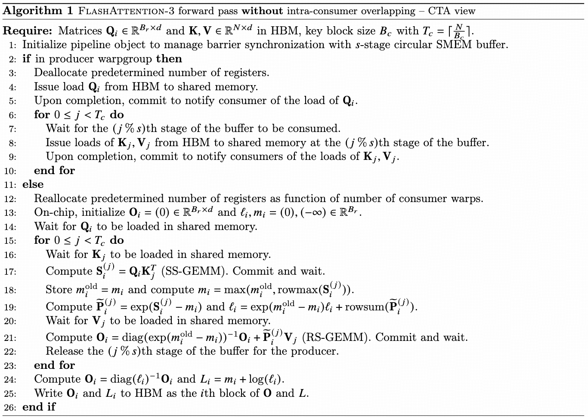
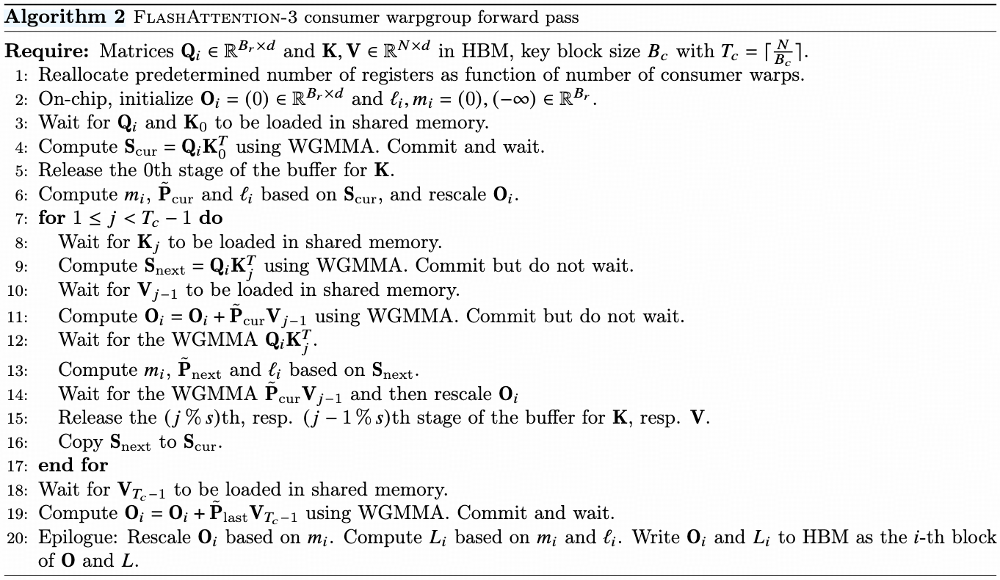

FlashAttention V3 的目标是**在 Hopper 架构（H100）上把 Attention 的计算效率进一步推向硬件上限**。它的核心思想和 [FlashAttention V1]({{ site.baseurl }})、[FlashAttention V2]({{ site.baseurl }}) 一致：通过 tiling 和 recompute，减少对 HBM 的读写；循环顺序和并行方式也沿用了 V2。

V2 在 H100 上只能达到约 35% 的硬件利用率，而优化好的 GEMM kernel 能达到 80%-90%。一部分原因是 V2 没有使用 Hopper 专属的指令；更根本的原因是 V2 的算法设计基于一个简单的同步模型，没有显式利用硬件的**异步执行**和**低精度**能力。V3 围绕这两点做了三项优化：

1. Producer-Consumer 异步：通过 warp specialization 把数据搬运和计算分给不同的 warp，并用 pingpong 调度让不同 warpgroup 的 softmax 和 GEMM 相互重叠；
2. 在一个 warpgroup 内部，把 softmax 隐藏在异步的分块 GEMM 之下；
3. 利用 FP8 Tensor Core 进行低精度 GEMM，并通过 block quantization 和 incoherent processing 降低精度损失。

## Hopper 的新特性

V3 的几项优化都建立在 Hopper 的硬件特性之上，先简单过一下。

**线程层次**：从细到粗依次是 thread、warp（32 个线程）、warpgroup（4 个连续的 warp）、thread block（CTA）、thread block cluster（Hopper 新增）和 grid。

**存储层次**（H100 SXM5）：

| 存储 | 容量 | 带宽 |
| --- | --- | --- |
| HBM（GMEM） | 80 GiB | 3.35 TB/s |
| L2 Cache | 50 MiB | 12 TB/s |
| Shared Memory（SMEM） | 每个 SM 228 KiB | 整卡 31 TB/s |
| Register（RMEM） | 每个 SM 256 KiB | - |

**异步执行**：

- **TMA**（Tensor Memory Accelerator）：专门负责 GMEM 和 SMEM 之间异步数据拷贝的硬件单元；
- **WGMMA**：Hopper 的 Tensor Core 通过 warpgroup 级别的 WGMMA 指令调用，和 Ampere 不同，它是**异步**的，并且可以直接从 shared memory 读取输入；
- **setmaxnreg**：可以在 warpgroup 之间动态重新分配寄存器，让做 MMA 的 warp 分到更多寄存器，而只负责发起 TMA 的 warp（只需要一个线程）少分一些。

有了这些异步硬件，就可以写 warp-specialized kernel：把一个 CTA 里的 warp 分成 producer 和 consumer 两种角色，producer 只负责搬数据，consumer 只负责计算。

**低精度**：WGMMA 使用 FP8 Tensor Core 时，单个 SM 的吞吐是 FP16/BF16 的 2 倍。但 FP8 WGMMA 对操作数的内存布局有额外限制（后面 FP8 一节会讲到）。

## Producer-Consumer 异步

### Warp specialization

和 V2 一样，V3 的 forward 在 batch_size、head_num 和 Q 的 seqlen 三个维度上并行，每个 CTA 负责一个 $$Q_i$$ 分块，计算对应的 $$O_i$$。

在一个 CTA 内部，V3 把 warpgroup 分成两种角色，中间用一个 $$s$$ 级的环形 SMEM buffer 衔接：

- **Producer warpgroup**：先释放一部分寄存器，然后用 TMA 把 $$Q_i$$ 和各个 $$K_j, V_j$$ 从 HBM 加载到 SMEM。每次加载前等待 buffer 中对应的 stage 被消费掉，加载完成后通知 consumer。
- **Consumer warpgroup**：先申请更多寄存器，然后等待数据到位，依次计算 $$S_i^{(j)} = Q_i K_j^T$$、online softmax 和 $$\tilde{P}_i^{(j)} V_j$$，用完后释放 buffer 中对应的 stage 给 producer。

consumer 主循环中的计算和 V2 一样，只在最后做一次 rescale：

$$
\begin{aligned}
S_i^{(j)} &= Q_i K_j^T \\
m_i^{old} &= m_i, \quad m_i = \max\left(m_i^{old}, \mathrm{rowmax}(S_i^{(j)})\right) \\
\tilde{P}_i^{(j)} &= \exp\left(S_i^{(j)} - m_i\right) \\
\ell_i &= e^{m_i^{old} - m_i} \ell_i + \mathrm{rowsum}(\tilde{P}_i^{(j)}) \\
O_i &= \mathrm{diag}\left(e^{m_i^{old} - m_i}\right) O_i + \tilde{P}_i^{(j)} V_j
\end{aligned}
$$

循环结束后计算 $$O_i = \mathrm{diag}(\ell_i)^{-1} O_i$$ 和 logsumexp $$L_i = m_i + \log(\ell_i)$$，写回 HBM。

由于 TMA 是异步的，发起一次加载不需要等其他加载完成；在 producer 主循环的前 $$s$$ 次迭代中，buffer 还没填满，也不需要任何等待。这样数据搬运就和计算重叠了起来，隐藏了访存和指令发射的延迟。

### Pingpong 调度

在现代硬件上，非 matmul 运算的吞吐远低于 matmul。以 H100 SXM5 为例，FP16 matmul 的峰值是 989 TFLOPs，而指数这类特殊函数只有 3.9 TFLOPs（每个 SM 每个时钟周期 16 次，乘以 132 个 SM 和 1830 MHz 主频）。

对于 head dimension 为 128 的 FP16 forward，matmul 的 FLOPs 是指数运算的 512 倍，但指数运算的吞吐低了 256 倍，所以指数运算的耗时能达到 matmul 的 50%。换成 FP8 情况更糟：matmul 吞吐翻倍，指数吞吐不变。

指数运算由单独的硬件单元（MUFU，multi-function unit）执行，理想情况下应该在 Tensor Core 做 matmul 的同时进行。为此，V3 用同步 barrier（`bar.sync`）强制 warpgroup 1 的 GEMM（本轮的 $$PV$$ 和下一轮的 $$QK^T$$）排在 warpgroup 2 的 GEMM 之前执行。这样 warpgroup 2 做 GEMM 时，warpgroup 1 正好在做 softmax；然后两者交换角色，warpgroup 2 做 softmax，warpgroup 1 做 GEMM，所以叫 pingpong 调度。

<!-- TODO: 插入论文中的 pingpong 调度示意图（Figure 1） -->

实际执行时的调度不会像示意图那样整齐，但通常都能带来提升。例如在 head dimension 128、seqlen 8192 的 FP16 forward 中，性能从 570 TFLOPs 提升到 620-640 TFLOPs。

## Warpgroup 内 GEMM 与 softmax 的重叠

即使在一个 warpgroup 内部，也可以让 softmax 的一部分指令和 GEMM 的一部分指令重叠。

难点在于主循环内存在顺序依赖：softmax 依赖第一个 GEMM 的输出 $$S_i^{(j)}$$，而第二个 GEMM 又以 softmax 的结果 $$\tilde{P}_i^{(j)}$$ 作为输入。如果按顺序执行，每个 GEMM 都要等上一步算完，softmax 和 GEMM 只能串行。

V3 的做法是**跨迭代做流水线**，用寄存器中额外的 buffer 打破依赖，得到一个 2-stage 的 GEMM-softmax 流水线。在第 $$j$$ 次迭代中：

1. 发起 $$S_{next} = Q_i K_j^T$$ 的 WGMMA，不等它完成；
2. 发起 $$O_i = O_i + \tilde{P}_{cur} V_{j-1}$$ 的 WGMMA，也不等它完成；
3. 等待 $$S_{next}$$ 算完，基于它计算 $$m_i$$、$$\tilde{P}_{next}$$ 和 $$\ell_i$$；
4. 等待 $$\tilde{P}_{cur} V_{j-1}$$ 算完，对 $$O_i$$ 做 rescale；
5. 释放 buffer 中对应的 stage，把 $$S_{next}$$ 拷贝到 $$S_{cur}$$。

也就是说，第 $$j$$ 次迭代的第二个 GEMM（$$PV$$）和第 $$j+1$$ 次迭代的 softmax 是重叠执行的。

<!-- TODO: 插入论文中的 2-stage WGMMA-softmax 流水线示意图（Figure 2） -->

实际实现中还需要考虑两点：

- **编译器重排**：NVCC 可能会重排指令，打乱精心设计的流水线顺序。论文分析了生成的 SASS 代码，确认编译器生成了预期的重叠代码。
- **寄存器压力**：2-stage 流水线需要在寄存器中多存一个 $$S_{next}$$，每个 thread block 多占用 $$B_r \times B_c \times 4$$ 字节的寄存器。这会和使用更大分块（同样很吃寄存器）产生冲突，需要根据 profiling 结果做权衡。

论文还提出了 3-stage 的版本，可以进一步让第二个 WGMMA 和 softmax 重叠，但需要更多寄存器，分块大小和流水线深度之间更难平衡。

## FP8 低精度

### 效率：布局变换

FP8 的 forward 在内存布局上有两个 FP16 中没有的问题。

**一是 V 的转置。** 对于 GEMM $$A \times B^T$$，如果操作数在 K 维（内积维）上连续，称为 k-major。FP16 WGMMA 对 SMEM 中的操作数没有要求，而 FP8 WGMMA 只支持 k-major。输入的 Q、K、V 通常在 head dimension 上连续，而第二个 GEMM（$$PV$$）要求 V 的分块在 seqlen 维度上连续，TMA 加载本身又不能改变连续维度。可选的方案有：

- 在 GMEM 中预先转置 V：要么融合进前一个算子（如 rotary embedding）的 epilogue，难以集成到通用库中；要么单独调用一个转置 kernel，在推理这种 memory-bound 的场景下太浪费。
- **在 kernel 内转置**：V3 选择了这种方案。加载到 SMEM 后，用 LDSM（ldmatrix）和 STSM（stmatrix）指令完成分块转置。这两条指令很省寄存器，可以放在 producer warpgroup 中执行；而且从第二次迭代开始，下一个 V 分块的转置可以藏在当前两个 WGMMA 的执行时间里。

**二是寄存器布局不一致。** FP8 WGMMA 的 FP32 累加器在寄存器中的布局，和它作为操作数 A 时要求的布局不同，所以第一个 GEMM 的输出 $$S$$ 不能直接作为第二个 GEMM 的输入。V3 用 byte permute 指令把累加器中每 8 个字节的顺序调整为 `d0 d1 d4 d5 d2 d3 d6 d7`，相当于对 P 分块的列做了一次置换；同时让 kernel 内转置写出的 V 分块做对应的行置换，保证 $$PV$$ 的结果不变。

### 精度：block quantization 和 incoherent processing

FP8（e4m3）只有 3 位尾数和 4 位指数，数值误差比 FP16/BF16 大得多。而且大模型中通常存在比其他值大得多的 outlier，让量化更加困难。常见做法是 per-tensor scaling，也就是 Q、K、V 各保留一个缩放系数。V3 用两种技术来降低 FP8 Attention 的误差：

- **Block quantization**：每个分块保留一个缩放系数，把 Q、K、V 按 $$B_r \times d$$ 或 $$B_c \times d$$ 的分块分别量化。量化可以融合进 Attention 之前的算子（如 rotary embedding，本身是 memory-bound 的），没有额外开销。由于 V3 本来就是分块计算的，对每个 $$S$$ 分块做对应的缩放也不需要额外计算。
- **Incoherent processing**：在量化成 FP8 之前，给 Q 和 K 都乘上同一个随机正交矩阵 $$M$$。因为 $$MM^T = I$$，所以

    $$(QM)(KM)^T = QMM^TK^T = QK^T$$

    Attention 的结果不变。而 $$QM$$、$$KM$$ 的每个元素都是 Q、K 中元素的随机加权和，相当于把 outlier "摊开"，从而降低量化误差。实践中 $$M$$ 取随机 $$\pm 1$$ 对角矩阵和 Hadamard 矩阵的乘积，乘法复杂度只有 $$O(d \log d)$$ 而不是 $$O(d^2)$$，同样可以融合进 rotary embedding 中，没有额外开销。

## Backward pass

Backward 同样使用 warp specialization，循环顺序沿用 V2：外层遍历 K、V，内层遍历 Q。区别在于除了 producer 和 consumer，V3 还增加了一个专门的 **dQ writer** 角色。

V2 中提到过，backward 需要把每个 thread block 算出的 $$dQ_i$$ 累加到全局的 dQ 上，多个 thread block 会同时写同一块内存，产生竞争。把这部分工作交给单独的 warp 异步完成，就不会阻塞其他 warp 继续做下一轮的 matmul。

## 算法

Algorithm 1 是不带 warpgroup 内重叠的 forward pass，对应前面 [Warp specialization](#warp-specialization) 一节：producer warpgroup（第 2-10 行）负责用 TMA 加载 $$Q_i$$ 和各个 $$K_j, V_j$$，consumer warpgroup（第 11-26 行）负责计算。

{: .mx-auto.d-block :}

Algorithm 1 FlashAttention-3 forward pass（CTA 视角），图源：<a href="https://arxiv.org/abs/2407.08608">FlashAttention-3</a>

Algorithm 2 用 2-stage 流水线替换了 Algorithm 1 中 consumer 的部分（第 11-26 行），两者合起来就是完整的 FP16 forward pass，对应前面 [Warpgroup 内 GEMM 与 softmax 的重叠](#warpgroup-内-gemm-与-softmax-的重叠) 一节。主循环中，第 $$j$$ 次迭代的第二个 WGMMA（第 11 行）和第 $$j+1$$ 次迭代的 softmax（第 13 行）重叠执行。

{: .mx-auto.d-block :}

Algorithm 2 FlashAttention-3 consumer warpgroup forward pass，图源：<a href="https://arxiv.org/abs/2407.08608">FlashAttention-3</a>

## 效果

<!-- TODO: 插入论文中的实验结果图（Fig. 5 - Fig. 7） -->

论文在 H100 80GB SXM5 上测量了不同 Attention 实现的运行时间，覆盖有无 causal mask、head dimension 为 64、128 或 256 的几种设置：

| 对比对象 | FlashAttention-3（FP16）的加速比 |
| --- | --- |
| FlashAttention-2 | forward 约 1.5-2.0×，backward 约 1.5-1.75× |
| Triton 实现的 FlashAttention-2（使用了 H100 专属指令） | 约 1.5× |
| PyTorch 标准 Attention 实现 | 约 3-16× |

- FP16 最高达到 740 TFLOPs/s，是 H100 理论峰值的 75%；
- 对于中长序列（1k 及以上），FP16 甚至超过了 NVIDIA 闭源的 cuDNN 中针对 H100 优化过的实现；
- FP8 forward 接近 1.2 PFLOPs/s。

Benchmark 设置：

- seqlen 取 512、1k、……、16k，并调整 batch size，使总 token 数固定为 16k；
- hidden dimension 为 2048，head dimension 为 64、128 或 256（对应 32、16 或 8 个 head）；
- forward 的 FLOPs 按 $$4 \cdot seqlen^2 \cdot head\_dim \cdot num\_heads$$ 计算，加 causal mask 时除以 2；backward 的 FLOPs 按 forward 的 2.5 倍计算（forward 有 2 个 matmul，backward 由于重计算有 5 个）。

### 消融实验

固定 batch=4、seqlen=8448、nheads=16、hdim=128，测试非 causal 的 FP16 forward：

| 配置 | 耗时 | TFLOPs/s |
| --- | --- | --- |
| FlashAttention-3 | 3.538 ms | 661 |
| 无 GEMM-softmax 流水线，有 warp specialization | 4.021 ms | 582 |
| 有 GEMM-softmax 流水线，无 warp specialization | 4.105 ms | 570 |

两项异步优化（warp specialization 和 GEMM-softmax 流水线）共同把性能从 570 TFLOPs/s 提升到了 661 TFLOPs/s。

### 数值误差

为了模拟大模型中的 outlier，Q、K、V 的每个元素按 $$\mathcal{N}(0,1)+\mathcal{N}(0,100)\cdot\mathrm{Bernoulli}(0.001)$$ 生成，即 0.1% 的元素额外叠加一个标准差为 10 的正态分布。以 FP64 实现为参照，计算 RMSE：

| 方法 | RMSE |
| --- | --- |
| 标准 Attention（FP16） | 3.2e-4 |
| FlashAttention-2（FP16） | 1.9e-4 |
| FlashAttention-3（FP16） | 1.9e-4 |
| 标准 Attention（FP8，per-tensor scaling） | 2.4e-2 |
| FlashAttention-3（FP8） | 9.1e-3 |
| FlashAttention-3（FP8），无 block quantization | 9.3e-3 |
| FlashAttention-3（FP8），无 incoherent processing | 2.4e-2 |

- FP16 下，V2 和 V3 的误差一样，都比标准实现低 1.7 倍，因为 softmax 的中间结果保存在 FP32 中；
- FP8 下，得益于 block quantization 和 incoherent processing，V3 的误差比 per-tensor scaling 的标准实现低 2.6 倍。从消融结果看，outlier 场景下起主要作用的是 incoherent processing。

### 局限

论文提到的后续工作包括：针对 LLM 推理做优化、在 FP8 kernel 中引入 persistent kernel 设计，以及研究低精度 Attention 对大规模训练的影响。其中，FP16 版本使用了 persistent kernel 和负载均衡策略，而 FP8 版本没有，这也是 FP8 版本在短序列和 causal mask 场景下不如 cuDNN FP8 kernel 的部分原因。

## 参考

- Jay Shah, Ganesh Bikshandi, Ying Zhang, Vijay Thakkar, Pradeep Ramani, Tri Dao. [FlashAttention-3: Fast and Accurate Attention with Asynchrony and Low-precision](https://arxiv.org/abs/2407.08608). 2024.
- Tri Dao. [FlashAttention-2: Faster Attention with Better Parallelism and Work Partitioning](https://arxiv.org/abs/2307.08691). 2023.
- Tri Dao et al. [FlashAttention: Fast and Memory-Efficient Exact Attention with IO-Awareness](https://arxiv.org/abs/2205.14135). NeurIPS 2022.
